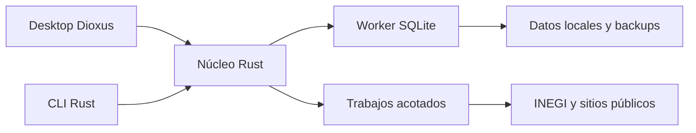

# Migrar a Rust para conseguir clientes

**Recomiendo Dioxus Desktop para macOS, con núcleo Rust independiente, SQLite local y dos perfiles comerciales.** Primero conservar todas las funciones y datos; después ampliar captación, CRM y análisis territorial.

Este documento conserva el **plan de migración y ampliación futura**. La primera versión personal ya está implementada en `/Users/asper/Business/Agencia/Rust business intelligence`. Consulta `README.md` y `docs/VERIFICACION_Y_LIMITES.md` para el estado real y los límites pendientes. Streamlit sigue disponible durante la validación diaria.

La prioridad es convertir establecimientos en conversaciones y oportunidades. Automatización/sistemas y web/marketing compartirán historial comercial, pero tendrán filtros, puntuaciones y mensajes diferentes.

## 1. Conservar la operación actual antes de ampliar BI

La revisión local parte del commit `c04328f`. La suite Python 3.14 obtuvo **1,097 pruebas aprobadas**, referencia funcional para el port.

La base SQLite usa `user_version=2`, ocupa 19,988,480 bytes y contiene **4,709 registros en prospectos**, 448 señales web y 227 entradas de caché. No faltan coordenadas.

Las tablas de actividad e interacciones están vacías. Los 4,709 registros representan establecimientos almacenados, no empresas únicas, decisores confirmados ni ventas. Las métricas comerciales requieren datos reales posteriores.

La migración debe cubrir interfaz, CLI, reglas, almacenamiento, configuración y exportación, con paridad funcional comprobable.

| Componente actual | Destino Rust | Condición de aceptación |
|---|---|---|
| `app.py`, `ui/trabajo`, `ui/base` | Rutas y componentes Dioxus | Hoy, Seguimientos, Conversaciones, Métricas y Cuentas/Base conservan acciones, filtros y selección. |
| `ui/theme`, `copiar`, `datos`, `debug`, assets | CSS local, servicios de sistema y herramientas de desarrollo | Tema claro/oscuro, scroll, copiar/abrir mensajes y CSV filtrado; debug ausente de release. |
| `denue.py` | Adaptador HTTP y DTO externo | Cuantificar y BuscarAreaActEstr mantienen paginación de 200, manejo de 429/5xx y redacción del token. |
| `pipeline.py` | Casos de uso y trabajos persistentes | Pull, analizar, refrescar y enriquecer producen cambios equivalentes, con progreso y cancelación. |
| `contacto.py`, `texto.py` | Normalización y extracción textual | Teléfono, email, URL, Unicode y HTML coinciden con fixtures actuales. |
| `giros.py`, `grupos.py` | Clasificación SCIAN e hipótesis de agrupación | Conserva motivos y grado débil/probable; ninguna agrupación acredita identidad legal. |
| `scoring.py`, `acciones.py` | Reglas de ajuste, prioridad y siguiente acción | Mismos valores y desgloses; puntuación no se presenta como probabilidad de venta. |
| `mensajes.py`, plantillas TOML | Motor de mensajes versionado | Mismos textos y variantes SHA-1; validación de afirmaciones y evidencia. |
| `db.py` | Repositorios SQLite y migraciones | Refrescar fuente nunca pisa estado, notas, actividad o interacciones. |
| `enrich.py` | Inspector de sitios públicos | Conserva límites, caché y barreras SSRF; extrae texto sin ejecutar HTML remoto. |
| `metricas.py` | SQL agregado y gráficos SVG | Embudo por etapa máxima; canal/variante del primer contacto y cortes comparables. |
| `__main__.py` | CLI con Clap | Cuantificar, pull, analizar, enriquecer, run, daily y export XLSX. |
| TOML, JSON, `.env.example`, README | Configuración tipada y documentación | Perfiles y rutas parametrizados; secretos excluidos; licencia MIT preservada. |
| Pruebas existentes | Tests de dominio, contratos y UI | Portar casos semánticos y añadir navegación, cancelación y fallos; no copiar conteos artificialmente. |

El enriquecimiento mantiene inicialmente cinco páginas por dominio, pausa de un segundo, timeout de cinco segundos, máximo 1 MB, tres redirecciones, caché de 30 días y ocho trabajadores.

El BI conserva cortes por giro/SCIAN, tamaño, municipio, canal y buckets. El aviso de muestra pequeña permanece; alcanzar 20 o 30 observaciones no demuestra significancia estadística.

Los datos del remitente y enlaces de Gmail actualmente fijos deben convertirse en preferencias. Preservar utilidad no exige portar los ajustes específicos del rerender de Streamlit.

## 2. Usar Desktop local con un núcleo compartido

**Dioxus 0.7.10 es la candidata estable observada; fijarla después del spike.** Desktop ejecuta Rust nativo y representa HTML/CSS mediante WebView del sistema. ([Versión](https://docs.rs/dioxus/0.7.10/dioxus/), [Desktop](https://dioxuslabs.com/learn/0.7/guides/platforms/desktop/))

No recomiendo Native experimental, LiveView ni una segunda capa Tauri para esta primera versión. Web/fullstack y multiusuario constituyen una expansión posterior con necesidades propias de servidor, acceso y secretos. ([Plataformas](https://dioxuslabs.com/learn/0.7/beyond/project_structure/))

Un workspace de **tres crates** evita fragmentación prematura: `core`, `desktop` y `cli`. El núcleo incluye dominio, casos de uso, almacenamiento, fuentes, scoring, CRM, mensajes y analítica.

La interfaz será un escritorio operativo con selector de oferta visible. Hoy, Seguimientos, Conversaciones, Cuentas/Base y Métricas organizan el trabajo; Territorios/Mercado llegará después.

| Capa | Elección inicial | Motivo y condición |
|---|---|---|
| Interfaz | Dioxus Desktop/Router, CSS y SVG locales | Rutas tipadas, componentes pequeños y tabla paginada. |
| Persistencia | Rusqlite con trabajador propietario | Una conexión administrada y escrituras serializadas; evaluar SQLx solamente si el spike justifica sustituirlo. |
| Concurrencia y red | Tokio y Reqwest | HTTP y consultas fuera del hilo de interfaz; clientes separados para INEGI y sitios empresariales. |
| Datos y validación | Serde, serde_json, TOML y tipos de dominio | DTO externo separado de comandos internos estrictos e invariantes explícitas. |
| Extracción y exportación | Scraper, CSV, rust_xlsxwriter | Extracción textual y formatos existentes; XLSX generado sin Python. |
| Operación | Clap y tracing | CLI reproducible, errores observables y logs sin tokens ni datos sensibles innecesarios. |
| Analítica | SQL y SVG | DuckDB/Polars condicionados a benchmarks posteriores. |

Rusqlite ofrece transacciones y backup SQLite. SQLx añade pools y migraciones asíncronas, pero no conviene introducir ambos drivers para una base operativa pequeña. ([Rusqlite](https://docs.rs/rusqlite/latest/rusqlite/), [SQLx](https://docs.rs/sqlx/latest/sqlx/))

Los datos vivirán en un directorio de aplicación del usuario, configurable. Nunca dentro del bundle `.app` ni dependiendo del directorio desde donde se inicia el programa.

Signals y context conectarán vistas con servicios. `use_resource` servirá para lecturas cancelables; las mutaciones CRM y lotes tendrán vida independiente del componente. ([Resources](https://dioxuslabs.com/learn/0.7/essentials/basics/resources/))

Cada trabajo tendrá identificador, estado, checkpoint, errores y cancelación cooperativa. Las colas serán acotadas y las acciones idempotentes; el progreso mostrará unidades conocidas, sin porcentajes inventados.

La primera prueba debe abrir una ventana macOS, consultar SQLite, mostrar tabla/SVG, cancelar HTTP, guardar y exportar, y generar un bundle ejecutable sin Python. Esto decide viabilidad antes del port completo.

SQLite seguirá inicialmente en su modo actual. Si después se habilita WAL, comprobar la versión real del motor corregida: WAL conserva un solo escritor y puede devolver bloqueos. ([SQLite WAL](https://sqlite.org/wal.html))

### Adaptar seguridad al ecosistema Rust

Serde no valida por sí sola reglas comerciales. Comandos internos rechazarán campos desconocidos; el DTO DENUE aceptará ampliaciones compatibles, pero exigirá campos indispensables y conversión validada. ([Serde](https://serde.rs/container-attrs.html))

El inspector bloqueará destinos privados, loopback, link-local y metadatos; verificará DNS y cada redirección, limitará descargas/descompresión y conservará TLS válido. ([OWASP SSRF](https://cheatsheetseries.owasp.org/cheatsheets/Server_Side_Request_Forgery_Prevention_Cheat_Sheet.html))

La interfaz mostrará texto escapado y evidencia. Los exports tratarán teléfonos y entradas externas como texto, evitando fórmulas inyectadas en CSV/XLSX.

Un timeout no detiene necesariamente trabajo iniciado con `spawn_blocking`. Operaciones hostiles que requieran terminación forzosa necesitan proceso aislado y límites reales. ([Tokio](https://docs.rs/tokio/latest/tokio/task/fn.spawn_blocking.html))

El spike documentará el alcance de la prohibición de `eval`: la aplicación no añadirá evaluación dinámica, aunque Dioxus Desktop utiliza mecanismos JavaScript internos. ([Renderer versionado](https://github.com/DioxusLabs/dioxus/blob/v0.7.10/packages/desktop/src/launch.rs))

Cargo ejecuta scripts y macros durante compilación. Revisar dependencias, licencias, procedencia, antigüedad mínima y allowlists; las opciones pnpm no se trasladan literalmente. ([Cargo](https://doc.rust-lang.org/cargo/reference/build-scripts.html), [cargo-deny](https://embarkstudios.github.io/cargo-deny/))

Aplicar SkillSpector a adquisiciones GitHub conforme a AGENTS; no se afirma protección activa.

## 3. Migrar datos mediante copia verificable y retorno seguro

**Crear una copia consistente con la API de backup de SQLite.** Copiar el archivo mientras está activo puede omitir estado persistente o producir una copia inconsistente. ([Backup oficial](https://sqlite.org/backup.html))

Antes del corte, ejecutar un inspector de solo lectura y un dry-run. Mantener inicialmente esquema v2 y guardar manifiesto con versión, hash, conteos y fecha del respaldo.

Preservar IDs, strings, NULL, campos JSON existentes, notas, estado CRM, evidencia, preferencias, plantillas, historial y seguimientos. No normalizar datos existentes silenciosamente durante importación.

Verificar `integrity_check` y relaciones con `foreign_key_check` cuando corresponda. Informar inconsistencias heredadas sin borrar registros. CSV no reemplaza el respaldo de una base con historia y relaciones.

Las migraciones posteriores serán numeradas, aditivas y con checksums. Cada cambio tendrá backup previo; el retorno restaurará una copia compatible, sin downgrade automático de esquema.

Después de ampliar el esquema, exigir exportación compatible o replay verificable y copia de recuperación antes de revertir. El modelo de oportunidades no garantiza reversibilidad automática hacia Streamlit.

Python y Rust se compararán sobre un snapshot consistente congelado y fecha inyectada, sin refrescar fuentes entre comparaciones. Revisar IDs, campos, puntuaciones/desgloses, hipótesis, variantes, pipeline, métricas y contenido de CSV/XLSX.

La importación repetida será idempotente. Streamlit y Rust nunca escribirán simultáneamente sobre la misma base durante el corte. El original congelado será fallback previo al uso real en Rust.

Tras trabajar en Rust, ensayar el retorno con una copia consistente actualizada compatible v2, incluyendo nuevas interacciones. Restaurar únicamente el original perdería ese trabajo reciente.

| Riesgo de paridad | Prueba obligatoria |
|---|---|
| Redondeo Python frente a Rust | Fixtures de empates: `round()` Python y `f64::round` difieren. |
| Unicode y contactos | Acentos, espacios, nombres mexicanos y normalización de teléfono/email/URL. |
| Variantes de mensaje | SHA-1 estable del ID; nunca sustituir por `DefaultHasher`. |
| Fechas locales sin zona | Preservar significado actual; no reasignar UTC silenciosamente. |
| Seguimientos y rótulos | Conservar lógica observada, incluidos desfases hoy+4/+7 en envíos tardíos; corregir después con migración explícita. |
| Refresh y CRM | Cambios DENUE no sobrescriben anotaciones ni acciones comerciales. |
| Interrupción o doble acción | Crash, cancelación, reanudación y doble clic no duplican mutaciones. |

Como actualmente no hay interacciones, usar fixtures sintéticos con historia comercial para probar compatibilidad. Nunca incorporar tokens, páginas privadas o contactos reales en fixtures publicados.

## 4. Mejorar captación con dos ofertas y fuentes gratuitas

**Separar perfiles comerciales aumenta utilidad antes que añadir dashboards.** El operador debe saber a quién contactar, por qué, mediante qué canal y cuál es la siguiente acción pendiente.

| Prioridad | Mejora | Resultado comprobable |
|---|---|---|
| P0, tras paridad | Perfiles de oferta, filtros guardados, búsqueda literal y paginación | Listas diferenciadas y razones visibles, sin excluir retail globalmente. |
| P0 | Contactabilidad, fecha, fuente y evidencia | Distinguir desconocido, encontrado, verificado e inactivo. |
| P0 | Trabajos reanudables y calidad de datos | Refresh confiable, duplicados revisables y continuidad sin conexión. |
| P1 | Cuentas, contactos y oportunidades por oferta | Historia compartida, decisor capturado y contactos duplicados evitados. |
| P1 | Cartera, cotizaciones, ingresos y embudo por perfil | Captura manual de clientes y ventas reales; propuestas separadas de escenarios. |
| P1 | Territorios y jornadas comerciales | Densidad y listas por proximidad; no prometer optimización de rutas. |
| P2 | Mercado sectorial, TIC, demografía y series | Contexto trazable para escoger nichos y ampliar ofertas. |
| P2 | Snapshots y alertas de cambios | “Nuevo en la fuente” o “no observado”; no inferir apertura/cierre. |

Automatización/sistemas comienza con la hipótesis existente: industria, logística y procesos repetibles en Puebla/Tlaxcala, estratos 11–100. Tamaño y actividad indican ajuste; la necesidad se confirma mediante evidencia o conversación.

Web/marketing tendrá sectores y pesos propios, incluyendo comercio y servicios. Un campo web vacío en DENUE significa desconocido, no ausencia de sitio ni intención de compra.

El modelo posterior incorporará `accounts`, `establishments`, `contacts`, `opportunities`, `offer_profiles` y scores por perfil/versión. Las interacciones serán compartidas para coordinar ambas ofertas.

Las agrupaciones por nombre, dominio o teléfono serán propuestas reversibles con explicación. CLEE ayuda al análisis, pero se verificará la estructura realmente publicada antes de usarla. ([Metadatos DENUE](https://www.inegi.org.mx/rnm/index.php/catalog/1103))

Plantillas y borradores locales mantendrán contacto manual. Registrar mensaje efectivamente enviado, oferta, variante, canal y resultado permitirá mejorar prioridades con evidencia propia, sin proveedor de envío pago.

### Elegir fuentes por utilidad y condiciones reales

INEGI permite explotación comercial con atribución y conservación de metadatos. Exportaciones incluirán fuente, producto, edición, geografía y transformaciones; nunca insinuarán aval institucional. ([Términos INEGI](https://www.inegi.org.mx/contenidos/inegi/doc/terminos_info.pdf))

| Fuente | Acceso y costo de servicio | Uso prioritario y límite |
|---|---|---|
| DENUE API + CSV local | Gratuito; API con token; archivos sin token | P0: búsqueda/contacto y snapshots offline. Campos pueden faltar; cuota API no verificada. [API](https://www.inegi.org.mx/servicios/api_denue.html), [descargas](https://www.inegi.org.mx/app/descarga/?ti=6). |
| Sitios empresariales | Páginas públicas; condiciones individuales | P0: contacto y señales verificables. Accesibilidad pública no autoriza republicación ilimitada. |
| Marco Geoestadístico | Descargas públicas sin token | P1: polígonos y puntos offline. Límites estadísticos no equivalen a límites políticos. [Programa](https://www.inegi.org.mx/programas/mg/default.html). |
| Censos Económicos 2024 | Tabulados gratuitos | P2: sectores y TIC; referencia económica principal 2023, información agregada. [Programa](https://www.inegi.org.mx/programas/ce/2024/default.html). |
| Población/Vivienda 2020 | Descargas sin token | P2: contexto de retail/servicios. Etiquetar 2020; no presentarlo como población actual. [Materiales](https://www.inegi.org.mx/rnm/index.php/catalog/632/related_materials). |
| Indicadores INEGI/BIE | Gratuito con token | P2: tendencias y unidades por serie; geografía disponible variable. [API](https://www.inegi.org.mx/servicios/api_indicadores.html). |
| Banxico SIE | Gratuito con token y cuotas | P2: contexto macro y cotizaciones; usar caché y límites documentados. [Límites](https://www.banxico.org.mx/SieAPIRest/service/v1/doc/limiteConsultas). |
| OSM | Datos ODbL, atribución y condiciones | Opcional: extractos/cartografía; servidores públicos sin garantía de servicio ilimitado. [Licencia](https://www.openstreetmap.org/copyright). |
| Data México / datos.gob.mx | Exploración pública; validación pendiente | No comprometer conector hasta comprobar recurso, disponibilidad, licencia y términos. [Data México](https://www.economia.gob.mx/datamexico/es/about/legal), [catálogo](https://www.datos.gob.mx/dataset/). |

Los mapas iniciales usarán geometrías INEGI y SVG local. Las coordenadas existentes evitan depender de Nominatim; los tiles públicos OSM no permiten descargas masivas offline. ([Nominatim](https://operations.osmfoundation.org/policies/nominatim/), [Tiles](https://operations.osmfoundation.org/policies/tiles/))

Las estadísticas TIC sugieren nichos, no diagnostican empresas. Separar establecimientos, cuentas, población, índices e ingresos; cada unión territorial requiere versiones compatibles y método explícito. ([CE2024](https://www.inegi.org.mx/contenidos/programas/ce/2024/doc/ce2024_presenta.pdf))

El mercado observable será el recuento filtrado. TAM/SAM/SOM e ingreso potencial serán escenarios con supuestos, nunca presupuestos individuales, tasas aprendidas inexistentes o predicciones de ventas.

“100% gratuito” significa **sin suscripciones ni créditos obligatorios**, usando la Mac existente. Hardware, almacenamiento, conexión y trabajo siguen teniendo costo; las APIs gratuitas conservan condiciones y límites.

La distribución pública macOS firmada puede requerir Apple Developer. Windows necesitará pruebas nativas y decisiones de firma/WebView2. El MVP de uso propio no necesita hosting contratado. ([Apple](https://developer.apple.com/programs/), [Bundling](https://dioxuslabs.com/learn/0.7/tutorial/bundle/))

DuckDB, Polars e IA local quedan opcionales. No depender de free tiers ni APIs con créditos. Recomendar conectores en este plan no acredita su integración ni pruebas desde Rust.

## 5. Ejecutar por entregas con criterios de salida

La secuencia termina primero una aplicación equivalente y después mejora el producto. Fijar fechas requiere medir el spike y la velocidad del port; este plan no promete un calendario.

| Entrega | Trabajo | Criterio de salida |
|---|---|---|
| 0: baseline y spike | Congelar fixtures, decisiones de renderer, toolchain/CLI y bundle | Tabla, SQLite, HTTP cancelable, SVG y export funcionan en macOS sin Python. |
| 1: núcleo y CLI | Portar dominio, fuente, reglas, SQLite v2 y comandos | Paridad sobre snapshots; backup/importación idempotentes; CRM conservado. |
| 2: interfaz | Cinco vistas, filtros, edición, tema, copiar/abrir y jobs | Flujos completos de trabajo y acciones persistidas; sin bloqueos perceptibles por I/O. |
| 3: corte | Dry-run real, fixtures históricos, comparación y empaquetado | Conteos del snapshot preservados (baseline 4,709); retorno probado con copia v2 actualizada y una nueva interacción creada en Rust. |
| 4: captación | Perfiles, calidad, cuentas/contactos/oportunidades | Dos listas explicables, historial compartido y métricas de respuesta por oferta. |
| 5: BI territorial | Geometrías, censos, indicadores y snapshots | Fuentes/versiones visibles; comparaciones reproducibles y funcionamiento offline. |

Cada entrega exigirá `cargo fmt --check`, Clippy, tests y build con lockfile, más `cargo deny check`. Ejecutar `cargo build --locked` evita resolver cambios imprevistos. ([Cargo build](https://doc.rust-lang.org/cargo/commands/cargo-build.html))

La validación incluirá fechas, SSRF, extracción HTML, fórmula en exports, restauración, fallos y cancelación. Las pruebas UI cubrirán edición, navegación, mensajes, filtros y acciones repetidas.

Medir con la base actual y fixtures sintéticos de 50,000 filas. Un objetivo propuesto de respuesta visual de 200 ms deberá comprobarse; no es rendimiento ya observado.

Sólo un benchmark insuficiente justificará añadir motores analíticos. La primera aceptación comercial será encontrar contactos utilizables, registrar conversaciones y recuperar seguimientos, antes que aumentar el número de gráficas.

La siguiente decisión concreta es completar el spike Desktop. Si supera sus condiciones, portar el núcleo contra fixtures congelados permitirá experimentar con Dioxus sin perder continuidad ni introducir gastos obligatorios.
