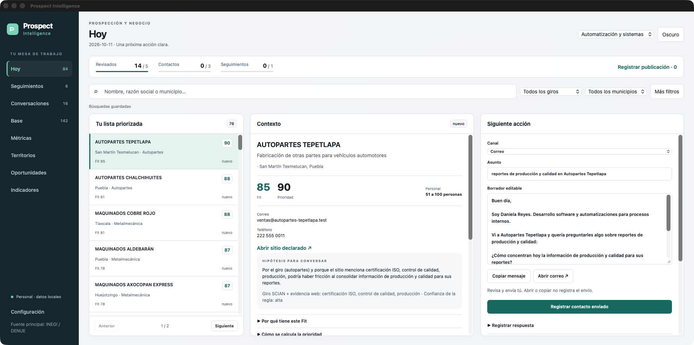

# Prospect Intelligence

[Español](README.md) | **English**

[](https://github.com/AsperSTS/rust-prospect-intelligence-engine/actions/workflows/ci.yml)
[](https://github.com/AsperSTS/rust-prospect-intelligence-engine/actions/workflows/release.yml)
[](LICENSE)

Local B2B prospecting tool built for Mexico. It turns public business registry data from INEGI (DENUE) into a prioritized lead queue, with contextual outreach drafts and an integrated SQLite CRM.



## What problem it solves

Most B2B lead tools charge USD subscriptions and have poor coverage for local businesses in Mexico. **Prospect Intelligence** runs 100% locally on SQLite with zero external servers:

- **Find real businesses:** import establishments from INEGI DENUE by state and industry code (SCIAN).
- **Prioritize who to contact:** score *fit* and priority using transparent JSON rules (industry, company size, and website signals) instead of black-box models.
- **Draft manual outreach:** generate editable message drafts and open your email or channel in one click (no automated sending; you stay in control).
- **Track your pipeline:** follow-ups, notes, conversion metrics, and deals in MXN/USD across separate service profiles.

## Platforms

- **macOS (Apple Silicon) & iOS:** native desktop bundle (`Prospect Intelligence.app`) plus iOS entry point (in development); macOS builds are published under [Releases](https://github.com/AsperSTS/rust-prospect-intelligence-engine/releases).
- **Windows (x64):** compiled, tested in CI, and packaged as a portable zip under [Releases](https://github.com/AsperSTS/rust-prospect-intelligence-engine/releases) (`ProspectIntelligence.exe` + `prospectos.exe`, pending manual testing on real Windows hardware; requires Microsoft Edge WebView2 Runtime, preinstalled on Windows 11).

## First launch

The app ships with no data or embedded credentials. On first launch, it walks you through entering your free API tokens (saved locally in `credentials.env` with `0600` permissions; see [`credentials.env.example`](credentials.env.example)):

| Token | Required | Purpose | Where to get it |
|---|---|---|---|
| `DENUE_TOKEN` | Yes | INEGI business directory | [INEGI DENUE API](https://www.inegi.org.mx/servicios/api_denue.html) |
| `INEGI_TOKEN` | Optional | Economic indicators | [INEGI Indicators API](https://www.inegi.org.mx/servicios/api_indicadores.html) |
| `BANXICO_TOKEN` | Optional | USD/MXN exchange rate | [Banxico SIE API](https://www.banxico.org.mx/SieAPIRest/service/v1/token) |

Data and backups are stored locally under `~/Library/Application Support/Prospect Intelligence/`.

**Portable backup:** Ajustes → Tokens y fuentes → "Crear respaldo" saves a `.zip` wherever you choose with the database, templates, settings and tokens (keep it private). On a fresh install, the first screen offers "Cargar respaldo" instead of starting from scratch.

## For developers

Rust workspace built with **Dioxus** and **SQLite** (`rusqlite`):

- `crates/core` — domain logic, SQLite storage, DENUE API client, deterministic scoring, and metrics.
- `crates/desktop` — Dioxus Desktop launcher.
- `crates/ui` — shared UI components and views.
- `crates/cli` — CLI utilities and database backups.
- `crates/mobile` — iOS entry point (WIP).
- `config/` — editable scoring rules, web signals, and message templates (`giros.json`, `senales.json`, `templates.toml`).
- `scripts/` — release packagers (`bundle-macos.sh`, `bundle-windows.sh`, `bundle-ios.sh`) and public hygiene checks (`verify-public-hygiene.sh`).
- `legacy/` — archived experimental UI variants (`simple_ui`), excluded from workspace builds.

```sh
# Run in development
cargo run --locked -p prospect-desktop

# Tests, linting, and dependency audit
cargo test --locked --workspace
cargo clippy --locked --workspace --all-targets -- -D warnings
cargo fmt --all -- --check
cargo deny --offline --locked check
```

## Contributing, security & license

- Guidelines and PR checks: [CONTRIBUTING.md](CONTRIBUTING.md)
- Private vulnerability reporting: [SECURITY.md](SECURITY.md)
- [MIT License](LICENSE) · Third-party notices: [THIRD_PARTY_NOTICES.md](THIRD_PARTY_NOTICES.md)
