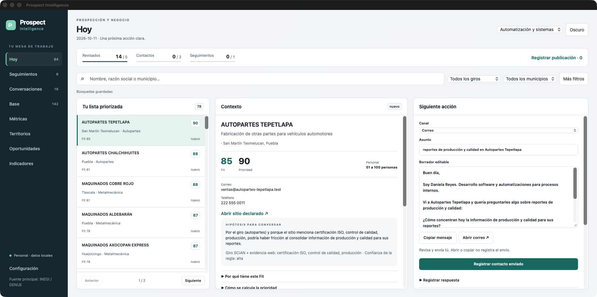
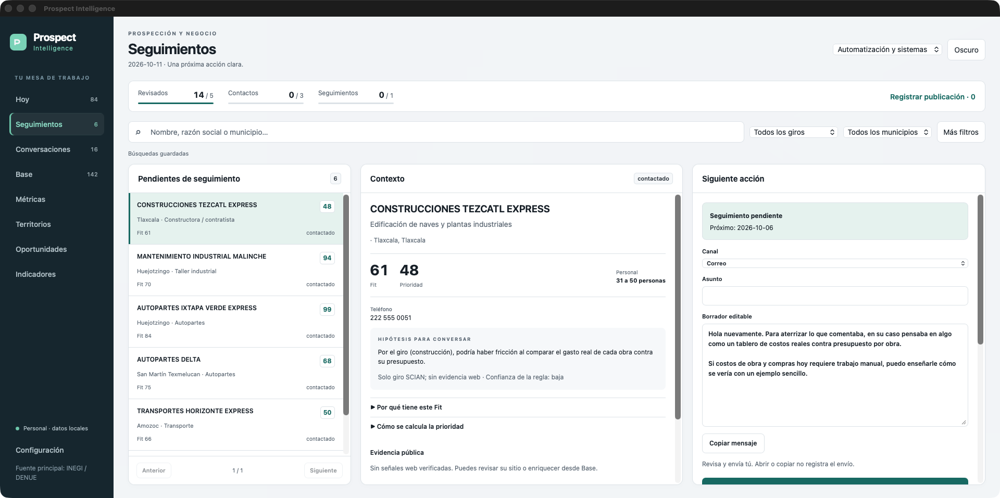
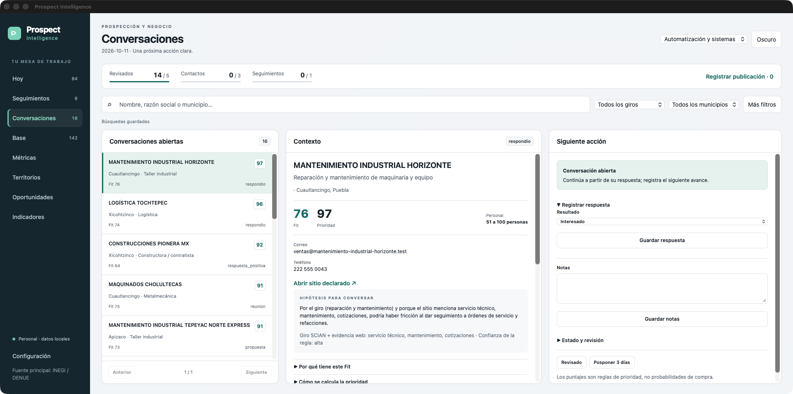
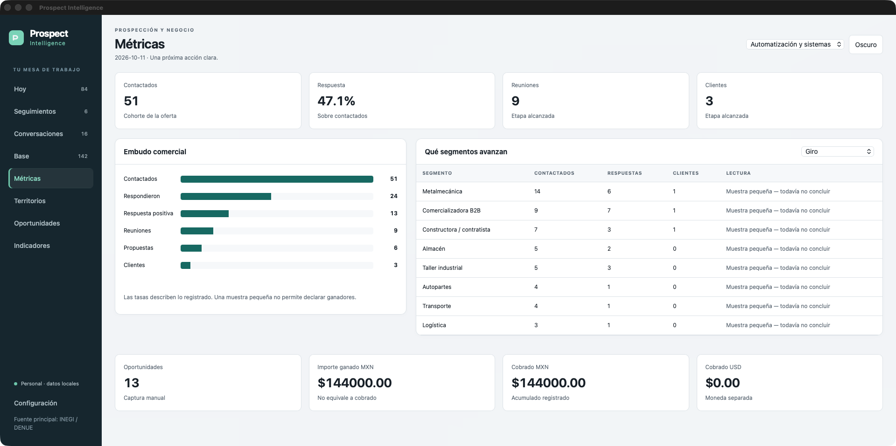
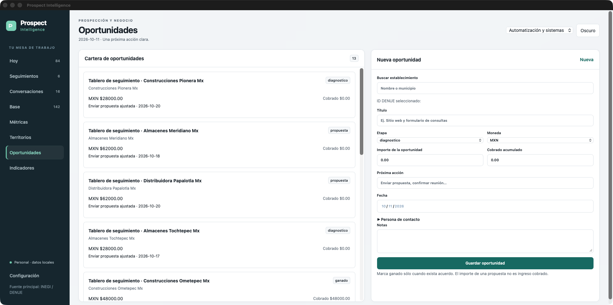

# Prospect Intelligence

Aplicación de escritorio en Rust y Dioxus Desktop para prospección B2B, calificación de cuentas y seguimiento comercial local. Utiliza datos públicos de INEGI (DENUE), persistencia en SQLite y reglas deterministas para priorización de contactos.

## Características

- **Persistencia local:** Base de datos SQLite (`prospectos.db`) en el directorio de usuario. No requiere servidores externos ni servicios de suscripción.
- **Calificación por reglas:** Cálculo explicable de *fit* y prioridad comercial mediante configuraciones JSON auditables, sin modelos opacos.
- **Enriquecimiento web:** Detección de señales técnicas, comerciales y de contacto en sitios web declarados por los establecimientos.
- **Contacto manual:** Generación de borradores contextuales a partir de evidencia y plantillas. La aplicación no realiza envíos automáticos ni registra interacciones sin acción explícita del usuario.
- **Métricas y oportunidades:** Control de conversiones por giro económico y seguimiento de importes presupuestados frente a cobros reales en MXN y USD.
- **Doble perfil de oferta:** Separación de reglas, puntuaciones y borradores para *Automatización y sistemas* y *Web y marketing*, manteniendo el historial compartido por establecimiento.

## Capturas de pantalla

### Lista priorizada del día
Flujo principal de trabajo: selección de prospectos según prioridad, desglose de evidencia web e hipótesis comercial, y edición del borrador de mensaje.



### Seguimientos
Control de contactos con fecha de seguimiento cumplida y generación de respuestas de seguimiento.



### Conversaciones abiertas
Seguimiento de prospectos en interacción, notas de avance y actualización de etapas del CRM.



### Métricas comerciales
Visualización del embudo de ventas, tasas de avance y comparativa por actividad económica.



### Cartera de oportunidades
Administración de propuestas comerciales con desglose independiente de importes cotizados y cobros acumulados.



## Ejecución en macOS

### Binario empaquetado
El paquete compilado para Apple Silicon se encuentra en `dist/`:

```sh
open "dist/Prospect Intelligence.app"
```

También está disponible la imagen de disco montable en `dist/Prospect-Intelligence-0.2.1-macOS.dmg`.

## Estructura del proyecto

El repositorio está organizado como un workspace de Rust:

```text
.
├── Cargo.toml             # Configuración del workspace y perfil de release
├── crates/
│   ├── core/              # Dominio, almacenamiento SQLite (rusqlite), scoring y métricas
│   ├── desktop/           # Interfaz gráfica en Dioxus Desktop
│   └── cli/               # Interfaz de línea de comandos para gestión de datos y backups
├── config/                # Diccionarios SCIAN, señales, reglas de scoring y plantillas
├── assets/                # Iconos del sistema y capturas
├── scripts/               # Scripts de compilación, empaquetado para macOS y utilidades
└── docs/                  # Documentación técnica, inventario de licencias y seguridad
```

## Desarrollo y verificación

Comandos para compilación, pruebas y análisis estático:

```sh
# Ejecutar en modo desarrollo
cargo run --locked -p prospect-desktop

# Ejecutar pruebas unitarias y de integración
cargo test --locked --workspace

# Análisis estático estricto con Clippy
cargo clippy --locked --workspace --all-targets -- -D warnings

# Verificación de formato
cargo fmt --all -- --check

# Auditoría de dependencias y licencias
cargo deny --offline --locked check

# Generar bundle .app y DMG para macOS
./scripts/bundle-macos.sh
./scripts/package-dmg.sh
```

## Datos y credenciales

- Los datos operativos, respaldos y plantillas se almacenan en `~/Library/Application Support/Prospect Intelligence/`.
- Los tokens de consulta para APIs públicas (INEGI DENUE, Banxico SIE) se configuran en el archivo privado `credentials.env` con permisos `0600`.
- El repositorio no almacena tokens, bases de datos comerciales reales ni exportaciones de contactos.

## Licencia

Distribuido bajo licencia [MIT](LICENSE). Las licencias de dependencias de terceros se detallan en [THIRD_PARTY_NOTICES.md](THIRD_PARTY_NOTICES.md).
